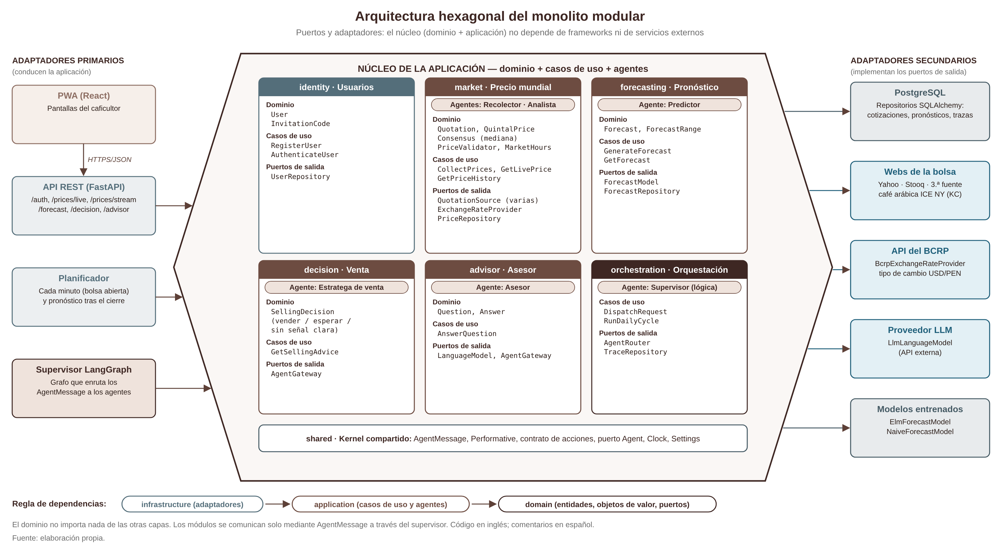
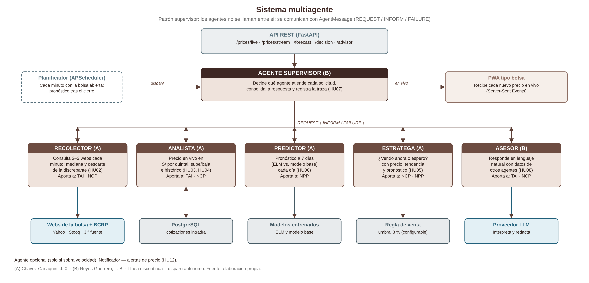
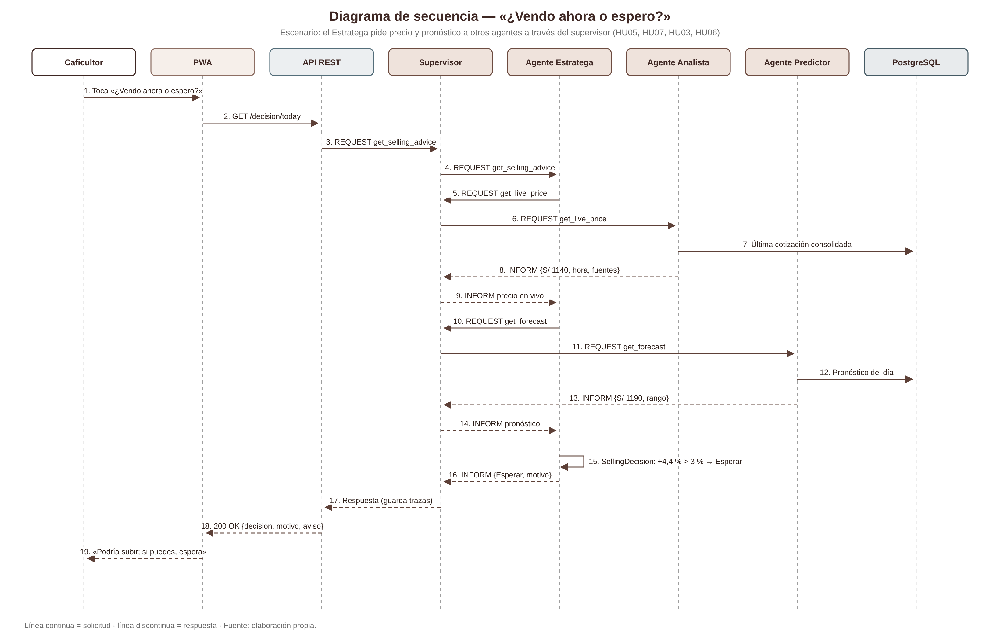
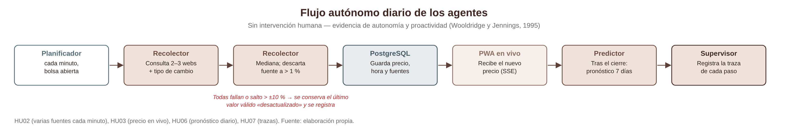

# Arquitectura

## Estilo

**Monolito modular con arquitectura hexagonal (puertos y adaptadores)** y un **sistema
multiagente con patrón supervisor**. Un solo despliegue, dividido en módulos independientes.

## Capas de cada módulo

| Capa | Contiene | Regla |
|---|---|---|
| `domain/` | Entidades, objetos de valor, servicios de dominio y **puertos** (interfaces `Protocol`) | No importa nada de las otras capas ni de frameworks |
| `application/` | Casos de uso y **agentes** (`application/agents/`) | Solo depende de `domain` |
| `infrastructure/` | Adaptadores: API (FastAPI y flujo en vivo), persistencia (SQLAlchemy), webs de la bolsa, LangGraph, LLM | Implementa los puertos |

`src/main.py` crea los adaptadores y los inyecta (inyección de dependencias manual, sin magia).

## Módulos

| Módulo | Agente(s) | Puertos de salida | Adaptadores |
|---|---|---|---|
| `identity` | — | `UserRepository`, `InvitationCodeRepository`, `PasswordHasher`, `TokenIssuer` | SQLAlchemy, bcrypt, JWT |
| `market` | Recolector, Analista | `QuotationSource` (una por web), `ExchangeRateProvider`, `PriceRepository` (cotizaciones, cierres y precios de cooperativas) | Yahoo Finance (yfinance, `KC=F`), Stooq (CSV, `KC.F`), API del BCRP, fuente DEMO, SQLAlchemy |
| `forecasting` | Predictor | `ForecastModel`, `ForecastRepository` | ELM (NumPy), modelo ingenuo con deriva, SQLAlchemy |
| `decision` | Estratega de venta | `AgentGateway` (pide datos a otros agentes) | — |
| `advisor` | Asesor | `LanguageModel`, `AgentGateway` | Palabras clave (sin internet), API de Anthropic |
| `orchestration` | Supervisor | `AgentRouter`, `TraceRepository` | LangGraph, SQLAlchemy, APScheduler |
| `shared` | — | `Agent`, `AgentGateway`, `Clock`, `TokenVerifier` | Reloj del sistema, base de datos, dependencias de FastAPI |

## Precio mundial en vivo (HU02, HU03)

1. Cada minuto, de lunes a viernes, el planificador pide `collect_prices` al Recolector.
2. El Recolector mira el horario de la bolsa de Nueva York (`MarketHours`, 04:15–13:30 hora de
   Nueva York). Con la bolsa cerrada no consulta nada.
3. Consulta **cada web configurada** (`QUOTATION_SOURCES`). Una web caída no detiene a las demás.
4. `Consensus` publica la **mediana** y descarta la web que se aleja más de 1 % de ella; si dos
   webs no coinciden entre sí, no se publica nada.
5. `PriceValidator` rechaza saltos mayores a ±10 % frente al último precio válido.
6. Se guarda la cotización en `live_quotes` (con su hora y sus fuentes) y se actualiza el
   cierre del día en `quotations` (histórico y pronóstico).
7. `GET /api/prices/stream` (Server-Sent Events) detecta la cotización nueva y la envía al
   celular, que se actualiza solo. Cada 15 s manda un «latido» para que la conexión no se corte.

> **Sobre el «tiempo real»:** los datos de ICE segundo a segundo requieren licencia. Las webs
> gratuitas publican con algunos minutos de retraso; por eso cada precio guarda y muestra la
> **hora de la cotización** y se marca como desactualizado si pasa de 20 min con la bolsa abierta.

## Precio estimado en Jaén (HU12)

Las cooperativas fijan su precio a partir de la bolsa. El equipo (rol **administrador**) pregunta
«¿a cuánto está el quintal ahora?» y lo anota en la pantalla «Equipo»
(`POST /api/admin/local-prices`). `RecordLocalPrice` guarda ese precio **junto al precio de la
bolsa de ese momento**; `LocalPriceObservation` rechaza porcentajes fuera de 40 %–120 % (error al
escribir). `LocalPriceEstimator` calcula, por tipo de café, la **mediana** de los porcentajes de
los últimos 30 días y `GetLivePrice` entrega `local_estimates` = bolsa en vivo × porcentaje, así
el estimado se mueve con la bolsa y llega al celular por el mismo flujo en vivo. Las rutas del
equipo exigen el rol en el token (`build_require_admin`); el front-end solo oculta la pantalla.

## Pronóstico estimado en Jaén (HU06 + HU12)

La pantalla «7 días» muestra el pronóstico de la bolsa y, al lado, el **estimado en Jaén** =
pronóstico × porcentaje que pagan las cooperativas por el tipo de café elegido. Es el precio que
el caficultor predice en la ficha de la TPP ([decisión 0009](decisiones/0009-pronostico-en-jaen.md)).
Se calcula en el front-end con dos respuestas existentes, sin que `forecasting` y `market` se
conozcan.

## Front-end

PWA en React + Vite organizada por pantallas (`src/features/`) y piezas compartidas
(`src/shared/`: cliente de la API y flujo en vivo, autenticación, textos en español, hooks y
animaciones con **Framer Motion** en `shared/motion/`). El diseño y la paleta están en
[paleta.md](paleta.md).

## Herramientas de desarrollo

`python dev.py setup | demo | start | test | check | admin | reset` funciona igual en Windows,
macOS y Linux; en local la base de datos es SQLite y en producción PostgreSQL
([decisión 0008](decisiones/0008-herramientas-simples.md)). Dependabot propone cada semana las
actualizaciones de dependencias y la CI las valida.

## Cómo se comunican los agentes

- Todo pedido a un agente es un `AgentMessage` con **performativa** `REQUEST`, `INFORM` o `FAILURE`.
- Nadie llama a un agente directamente: la API, el planificador, el Estratega y el Asesor usan el
  puerto `AgentGateway`, implementado por el supervisor (`DispatchRequest`).
- El supervisor delega en `LangGraphAgentRouter`: un grafo con un nodo por agente. Si un agente
  lanza una excepción, el nodo la convierte en `FAILURE`: el sistema nunca se cae por un agente.
- Cada interacción queda en la tabla `agent_traces` (agente, acción, duración, resultado).

Los nombres de agentes y acciones son un **contrato** en `shared/domain/contract.py`.

## «¿Vendo ahora o espero?» (HU05)

El Estratega no conoce a los otros módulos: pide `get_live_price` al Analista y `get_forecast`
al Predictor a través del supervisor y aplica la regla `SellingDecision`:

| Respuesta | Condición (umbral configurable, 3 % por defecto) |
|---|---|
| **Esperar** | El mejor precio esperado en 7 días supera al de hoy en más del umbral **y** el límite inferior de su rango no baja del precio de hoy |
| **Vender ahora** | El precio esperado al final del horizonte cae más del umbral |
| **Sin señal clara** | En otro caso |
| **Sin datos suficientes** | El precio está desactualizado o no hay pronóstico reciente |

Siempre explica el motivo con números y muestra el aviso «la decisión de vender siempre es tuya».
Su acierto se mide con `scripts/backtest_selling_rule.py` ([decisión 0007](decisiones/0007-regla-de-venta-explicable.md)).
El Asesor sigue el mismo camino cuando le preguntan «¿vendo o espero?».

## Comportamiento autónomo

| Disparo (hora de Lima, lunes a viernes) | Qué hace |
|---|---|
| Cada minuto | `CollectLivePrices` → Recolector (solo consulta con la bolsa abierta) |
| 14:05 (después del cierre) | `RunDailyCycle`: Recolector (cierre, `force`) → Analista (histórico) → Predictor |

## Propiedades de agente inteligente (Wooldridge y Jennings, 1995)

| Agente | Autonomía | Reactividad | Proactividad | Habilidad social |
|---|---|---|---|---|
| Supervisor | Decide la ruta | Atiende cada solicitud y FAILURE | — | Intercambia mensajes con todos |
| Recolector | Se ejecuta solo cada minuto según el horario de la bolsa | Descarta la web discrepante y conserva el último valor válido | Mantiene el precio al día antes de que se pida | Informa al supervisor |
| Analista | Parcial | Responde cada REQUEST | — | Responde INFORM |
| Predictor | Pronostica cada día solo | Atiende solicitudes | Elige el modelo con menor error | Informa al supervisor |
| Estratega | Decide qué recomendar | Recalcula con cada consulta | Se abstiene si los datos están desactualizados | Pide datos a Analista y Predictor |
| Asesor | Decide qué datos necesita | Responde cada pregunta | Advierte cuando no sabe | Pide datos a otros agentes |
